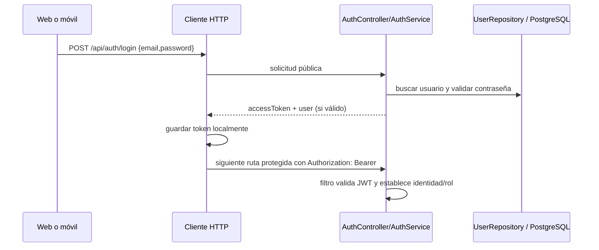

# Flujo de autenticación

## Inicio de sesión compartido por canales

El contrato de login está en `AuthController`, `AuthService`, DTOs de auth. Password hashing usa `PasswordEncoderConfig`; JWT se valida con `JwtAuthenticationFilter`/`JwtService`. El token no es una sesión de servidor: `SecurityConfig` declara `STATELESS`.

## Diferencias entre clientes

- **Móvil:** `ApiClient` obtiene token desde `SecureTokenStorage` (almacenamiento seguro), añade Bearer según la opción `authenticated` y ante 401 ejecuta `onUnauthorized`, que limpia la sesión. `auth_remote_data_source.dart` usa login sin autenticación. No se observó refresh token.
- **Web:** `authStorage.ts` persiste `auth_token` y usuario en `localStorage`; `AuthContext.tsx` restaura estado y ofrece login/logout. `httpClient.ts` omite token para `/api/auth/**`, solicitud pública y alta pública de cooperativa; el resto lo adjunta si hay token. Un 401 autenticado emite evento y `AuthContext` reacciona.

## Registro y recuperación

Ambos clientes implementan rutas de registro OTP (`registration/start`, `verify-code`, `resend-code`, `change-email`, `set-password`), activación/registro legado y recuperación (`password/forgot`, `password/reset`). Móvil además inicia una solicitud de crédito pública desde su pantalla de registro; esto es una operación de negocio separada y no se debe describir como `POST /api/auth/register`.

## Roles y límites

El backend maneja roles como `CLIENT`, `COOPERATIVE` y `ADMIN`. La autorización HTTP general deriva de JWT y reglas de `SecurityConfig`; el backend debe ser la autoridad para acceso. La web separa dashboards cliente/cooperativa en páginas, pero ocultar una pantalla no prueba autorización. Revisar reglas específicas/controladores cuando cambie un flujo.

Rutas: `app_movil_dinerop/lib/features/auth/data/auth_remote_data_source.dart`, `lib/core/storage/secure_token_storage.dart`, `lib/core/network/api_client.dart`; `dinerup-app/src/api/auth/`, `src/context/AuthContext.tsx`, `src/api/httpClient.ts`; backend `auth/controller`, `auth/service`, `auth/config`.
