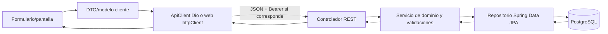

# Flujo de datos y persistencia

## Recorrido típico

1. La página/pantalla convierte el estado del formulario a un modelo de request. Ejemplos: móvil `CreditRequestPayload`, `OnboardingRequest`; web servicios `creditRequests.api.ts`, `onboarding.api.ts`.
2. El cliente serializa JSON y añade Bearer según el flujo. Móvil usa Dio; web usa `fetch`.
3. Controlador Java recibe DTO, y delega en servicio/caso de uso. Autenticación y autorización se ejecutan en filtros/reglas de Spring Security.
4. Servicios validan negocio y acceden a repositorios JPA. Las entidades/relaciones concretas y transacciones se deben seguir en el dominio correspondiente.
5. Respuesta JSON/PDF se convierte a modelos de presentación. Errores se normalizan de manera independiente por cada cliente.

## Datos de crédito

El backend distingue solicitud pública (`POST /api/credits/public-request`, datos de contacto e identidad incluidos) de solicitud autenticada (`POST /api/credits/me`, identidad de usuario y datos de solicitud). La distribución hacia cooperativas elegibles y su estado está en lógica de `credit`; repositorios `CreditRequestRepository`, `SolicitudCooperativaRepository` y entidades asociadas. No asumir que ambas modalidades crean idénticas filas/campos; revisar `CreditService` y DTOs. Respuestas al cliente alimentan lista, estados, ofertas preaprobadas y aceptación.

## Datos de onboarding

`OnboardingClienteController` recibe solicitante/conyuge, guarda contenido modelado por `SolicitudOnboarding`, `PersonaOnboarding`, direcciones, ingresos/egresos, actividad y referencias mediante repositorios de onboarding. Endpoint de garante completa información adicional. Vista cooperativa consulta el expediente. Para trazabilidad, revisar `onboarding/domain`, `onboarding/application` y `onboarding/infrastructure/repository`.

## Base y otras salidas

`application.yaml`/`application-prod.yaml`, `pom.xml`, `docker-compose.yml` configuran persistencia PostgreSQL. `schema.sql` es una referencia adicional, no necesariamente fuente única de verdad de esquema actual si Hibernate/migraciones divergen. Correo y push son salidas del backend (Resend/Firebase); los tokens push se registran mediante endpoint dedicado móvil. No se halló persistencia compartida directa de clientes a PostgreSQL.

## Límites verificados

Las apps no conectan directamente a PostgreSQL. El web incluye Supabase en dependencias, pero la documentación existente reporta que no detectó uso en código; no atribuir el almacenamiento de negocio a Supabase sin nuevas pruebas. El endpoint web `mi-ubicacion` no tiene mapping cotejado, así que su recorrido de datos queda sin confirmar.
