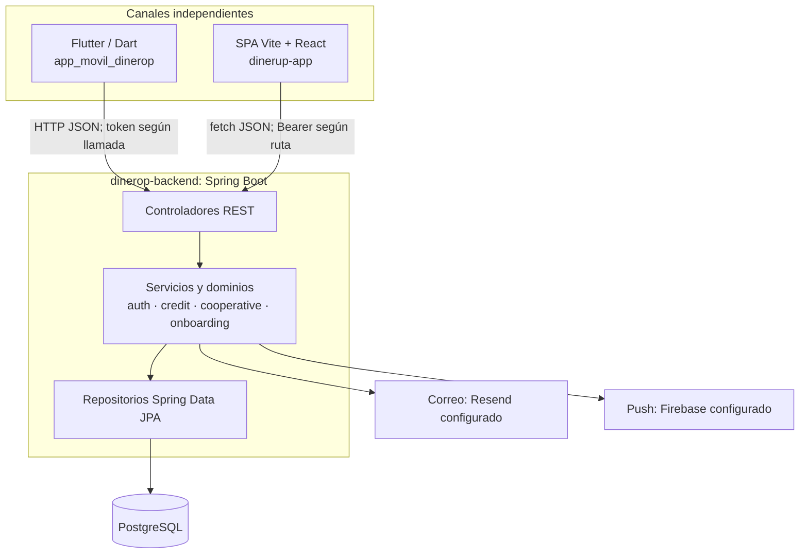

# Arquitectura global

## Vista de contexto

Las conexiones cliente→API están probadas por las rutas en los clientes y mappings de los controladores. Las llamadas a servicios externos se basan en configuración/código backend; no representan dependencias entre los tres repositorios.

## Backend

Es un monolito Spring Boot organizado por dominios, no tres servicios distribuidos independientes. `docs/ARCHITECTURE.md` describe capas mixtas: `credit` y `cooperative` separan dominio/infraestructura; `onboarding` tiene application/domain/infrastructure; `auth` usa controller/service/repository/entity. `OnboardingServiceImpl` coordina directamente `CreditService` en proceso. También hay un `CreditServiceClient` HTTP en onboarding; su uso concreto debe seguirse en código antes de afirmar qué servicio remoto representa.

Puntos de entrada: `src/main/java/com/markup/dinerop/{auth/controller,credit/infrastructure/web,cooperative/infrastructure/web,onboarding/controller}`. Seguridad y CORS: `auth/config/SecurityConfig.java`; JWT: `auth/config/JwtAuthenticationFilter.java` y `auth/service/JwtService.java`. Persistencia: repositorios JPA bajo cada dominio; esquema auxiliar en `schema.sql`.

## Clientes

- Móvil: `main.dart` → `app/app.dart` → GoRouter → feature presentation/providers → repositorios o data sources → Dio `ApiClient`. DI y token interceptor: `lib/core/di.dart`, `lib/core/network/api_client.dart`; configuración base: `lib/core/config/api_config.dart`.
- Web: `src/main.tsx` → `AuthProvider`/router → páginas y componentes → `src/api/*` → `httpClient.ts` (`fetch`). Token en `localStorage` mediante `authStorage.ts`; configuración mediante `VITE_API_BASE_URL`.

No hay evidencia de que un cliente invoque al otro. Comparten conceptos y algunos contratos HTTP; no comparten paquetes compilados.

## Entornos y despliegue observables

El móvil puede sobrescribir base URL por `DINEROP_API_BASE_URL` y tiene un fallback Railway en `api_config.dart`. La web exige `VITE_API_BASE_URL`; `src/api/config.ts` falla si falta. El backend documenta `https://api.dinerop.com` en `API_DOCUMENTATION.md`, mientras el código móvil fija otro host Railway por defecto: esto es una diferencia de configuración, no prueba de cuál URL está activa actualmente. `vercel.json` y `netlify.toml` contienen reglas SPA para la web. No inferir topología productiva a partir de estos valores únicamente.

## Grafo de conocimiento

Cada `graphify-out/GRAPH_REPORT.md` documenta un snapshot local y fecha/commit de generación. `global-graph.json` combina nodos etiquetados por repositorio. Úsese para buscar hubs y relaciones internas; confirme freshness y aristas críticas contra fuentes. Métricas de centralidad no equivalen a propiedad del dominio ni integración runtime.
