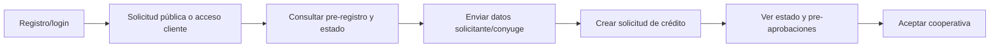
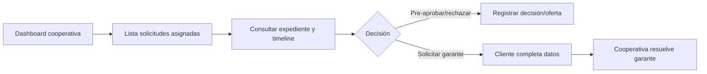

# Flujos principales de usuario

Estos flujos resumen acciones observables en pantallas/servicios y rutas API; no afirman disponibilidad productiva.

## Cliente: registro, onboarding y solicitud

Web: `Login.tsx`, `OnboardingPage.tsx`, `DashboardClient.tsx`, modales de crédito. Móvil: features `auth`, `onboarding`, `credit`, `requests`. La relación backend es visible en `onboarding.api.ts`/`onboarding_repository.dart` y `creditRequests.api.ts`/`credit_repository.dart`. El orden exacto puede variar: solicitud pública y onboarding no son un único flujo obligatorio según los contratos observados.

## Cooperativa: revisar, decidir y atender garante

La web consume bandeja, detalle onboarding, timeline, valores de oferta y decisiones en `DashboardCooperative.tsx`, `creditRequests.api.ts` y `onboarding.api.ts`. No se encontró consumidor móvil de estas operaciones de bandeja/decisión.

## Catálogo y exploración

Ambas aplicaciones piden `GET /api/cooperatives`. Web también presenta directorios/componentes de cooperativas; móvil usa `CooperativeRepository`. Los simuladores y catálogos estáticos deben distinguirse de una cotización calculada por backend: confirmar servicio invocado para cada acción.

## Recuperación de cuenta

Ambos clientes pueden iniciar recuperación de contraseña, abrir el enlace/token recibido y solicitar reset. Backend ofrece `POST /api/auth/password/forgot` y `/reset`; el canal de entrega (email) se implementa en backend.

Referencias de navegación: `app_movil_dinerop/docs/NAVIGATION.md`, `docs/MODULES.md`; `dinerup-app/docs/PAGES_AND_ROUTES.md`, `docs/MODULES.md`; controladores listados en [API-INTEGRATIONS.md](API-INTEGRATIONS.md).
