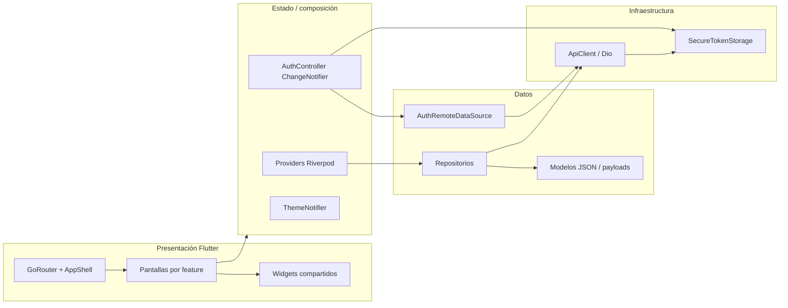
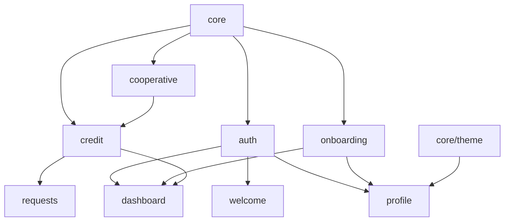

# Arquitectura

## Estilo y límites

La aplicación está organizada principalmente por feature (`lib/features/<feature>/`) y por responsabilidad. La separación no es completamente uniforme: auth tiene `data`, `presentation/screens` y controlador; crédito y onboarding tienen repositorio/modelos; dashboard, perfil y solicitudes son mayormente presentación y reutilizan repositorios/providers registrados globalmente.

## Composición y flujo

`main()` inicializa Flutter, Firebase (con fallo tolerado) y los datos de fecha en español; envuelve `DineropApp` en `ProviderScope`. `DineropApp` observa router y tema y construye `MaterialApp.router`. `core/di.dart` crea almacenamiento seguro y `ApiClient`; providers de `app/providers.dart` componen repositorios de crédito/cooperativas y queries `FutureProvider.autoDispose`. Los proveedores de auth/onboarding se declaran junto a `auth_controller.dart`.

El flujo típico de datos es UI → provider/controlador → repositorio o data source → ApiClient → Dio/interceptor → backend. Respuestas JSON se convierten a modelos en repositorios/data sources; el estado asíncrono se representa con `AsyncValue` en providers o propiedades del `AuthController`.

## Dependencias entre módulos

- `core` no depende de pantallas; ofrece red, almacenamiento, configuración, excepciones, tema y notificaciones.
- `auth` depende de red/storage, y su controlador también consulta onboarding y registra push tras iniciar sesión.
- `onboarding` depende de `ApiClient` y de sus DTO.
- `credit` depende de `ApiClient` y reutiliza `CooperativeSummary` del módulo cooperative.
- `dashboard` combina auth, onboarding, solicitudes y perfil.
- `requests` consume `CreditRepository` y modelos de crédito, y puede iniciar onboarding.
- `profile` consume auth, perfil cliente y tema.
- `welcome` consume auth para decidir navegación y usa widgets propios de presentación.

Las relaciones están verificadas en imports/providers y concuerdan con el grafo Graphify (`authControllerProvider` tiene referencias desde pantallas de auth, dashboard, onboarding, perfil y welcome; `ApiClient` es compartido por auth, crédito, onboarding, cooperative y push). No hay una capa de dominio/use cases independiente evidente en `lib/`.

## Referencias

[`lib/main.dart`](../lib/main.dart), [`lib/app/app.dart`](../lib/app/app.dart), [`lib/app/providers.dart`](../lib/app/providers.dart), [`lib/core/di.dart`](../lib/core/di.dart), [`lib/core/network/api_client.dart`](../lib/core/network/api_client.dart), [`lib/features/auth/presentation/auth_controller.dart`](../lib/features/auth/presentation/auth_controller.dart).
