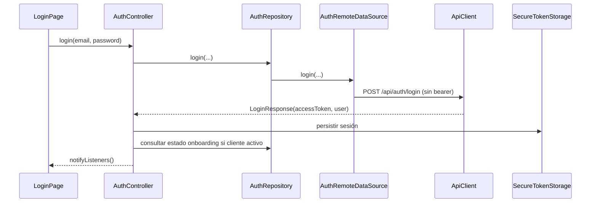

# Autenticación y sesión

## Flujo

En bootstrap el controlador intenta leer la sesión guardada; valida estado de onboarding para cliente activo. El router escucha el controlador y redirige según `isBootstrapping`, `isAuthenticated` y `requiresActivation`. El token se añade como `Authorization: Bearer ...` a requests autenticados por interceptor. Al recibir 401 el callback elimina almacenamiento; al cerrar sesión se limpia almacenamiento y estado en memoria.

## Datos de sesión

`SecureTokenStorage` guarda el token, serialización JSON del usuario y flag de onboarding con keys privadas de implementación. `FlutterSecureStorage` es provisto por `core/di.dart`. No almacenar credenciales de contraseña en sesión. También se persisten tema y marca de bienvenida. `clear()` llama `deleteAll`, por lo que borra también esas preferencias.

`AppUser` representa id/email/role/status y ofrece `isClient`, `isActive`, `isPendingActivation`. Login solo conserva acceso y resumen del usuario. `AuthController` también maneja último correo, busy, error, bootstrap y flags de activación/onboarding.

## Registro, activación y recuperación

Las páginas de registro, verificación, activación, creación de contraseña y recuperación usan métodos del mismo `AuthController`; las peticiones son públicas (`authenticated: false`). El alta pública de cliente usa `/api/credits/public-request`. Activación y reset reciben tokens en query params de la ruta, pero los tokens se transmiten al endpoint como query/body y no se persisten como sesión. El login exitoso registra FCM de forma no bloqueante.

## Consideraciones observadas

El cliente no contiene flujo de refresh de JWT. Un token ausente no impide técnicamente request; endpoints protegidos devolverán error. El inicio tolera fallo de Firebase. `ApiClient` evita loguear headers/body mediante su `LogInterceptor` desactivado y el interceptor 401 no imprime token. Los mensajes de depuración muestran URL base, método/ruta y resultados; revisar configuración por entorno antes de habilitar logging en builds sensibles.

## Referencias

[`auth_controller.dart`](../lib/features/auth/presentation/auth_controller.dart), [`auth_repository.dart`](../lib/features/auth/data/auth_repository.dart), [`auth_remote_data_source.dart`](../lib/features/auth/data/auth_remote_data_source.dart), [`secure_token_storage.dart`](../lib/core/storage/secure_token_storage.dart), [`api_client.dart`](../lib/core/network/api_client.dart), [`app_router.dart`](../lib/app/router/app_router.dart).
