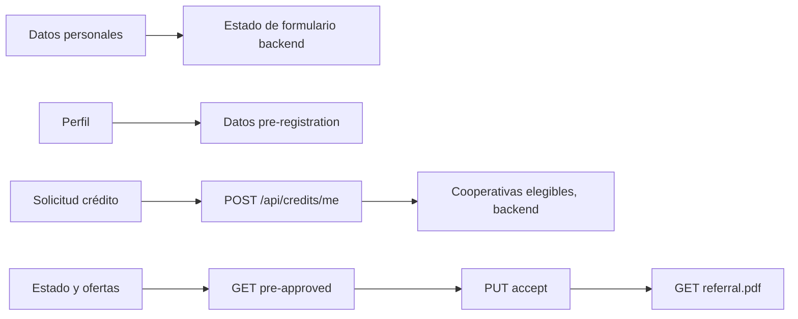

# Lógica de negocio visible en cliente

Este documento resume reglas implementadas en cliente; la autorización y validación definitiva pertenecen al backend.

## Crédito e inversión

`CreditRequestPayload` mapea a contrato `POST /api/credits/me`: monto → `monto`; tipo enum → `CREDITO`/`INVERSION`; tipo de crédito se convierte a mayúsculas o `null` para unknown/ausente; plazo, provincia y ciudad son opcionales. Las opciones visibles se describen en `credit_enums.dart`. El cliente no debe asumir elegibilidad/aprobación local; el backend distribuye y devuelve estados.

La lista de solicitudes tolera respuesta nula, objeto individual o lista y convierte `solicitudId`, estado, monto, tipo, fecha y cantidad de envíos. Ofertas preaprobadas incluyen tasa, cuota, total/interés, requisitos y detalles opcionales. La UI permite aceptar una cooperativa mediante PUT y pedir PDF de referencia. Reglas de estados con fallback desconocido están en los conversores enum.

Simuladores de crédito e inversión son pantallas separadas; la fuente debe ser consultada para fórmulas exactas. La documentación no fija fórmulas porque el cálculo debe verificarse dentro de cada implementación antes de mantenerlas.

## Onboarding

`OnboardingClientRequest` encapsula destino, solicitante y cónyuge opcional. Persona serializa fecha ISO `yyyy-MM-dd`, dirección, actividad económica, ingresos/egresos y referencias. Para garante se envía persona plana, sin wrapper, y el repositorio quita `email` porque el DTO backend no lo recibe. `onboarding_page.dart` administra los pasos/campos del formulario; el backend responde el estado y submission.

## Registro y perfil

El registro público crea una solicitud mediante `/api/credits/public-request`; luego el flujo incluye verificación/cambio de correo/establecer contraseña según pantallas y endpoints de auth. El controlador guarda el último email para continuidad entre pantallas. Perfil combina datos precargados del endpoint autenticado de onboarding con email/estado de auth y permite cambiar tema o cerrar sesión.

## Dependencias de negocio

Fuentes: [`credit_request_payload.dart`](../lib/features/credit/data/models/credit_request_payload.dart), [`credit_repository.dart`](../lib/features/credit/data/credit_repository.dart), [`onboarding_request.dart`](../lib/features/onboarding/data/models/onboarding_request.dart), [`onboarding_repository.dart`](../lib/features/onboarding/data/onboarding_repository.dart), [`auth_controller.dart`](../lib/features/auth/presentation/auth_controller.dart), [`profile_page.dart`](../lib/features/profile/presentation/profile_page.dart).
