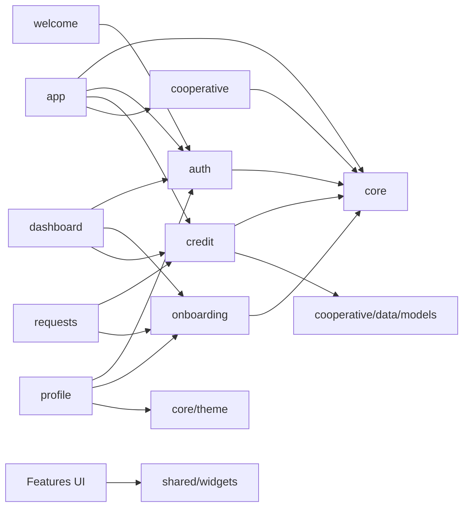

# Módulos y responsabilidades

| Módulo | Responsabilidad observada | Entrada/salida y dependencias | Rutas/pantallas principales |
|---|---|---|---|
| `app` | Arranque, composición, routing, shell y providers transversales | Compone `core` y `features` | [`app_router.dart`](../lib/app/router/app_router.dart) |
| `core/config`, `network`, `di` | Resolver URL, construir Dio y añadir bearer token/error mapping | Storage seguro → `ApiClient` → módulos de datos | [`di.dart`](../lib/core/di.dart) |
| `core/storage` | Persistir sesión, tema y bienvenida | FlutterSecureStorage | [`secure_token_storage.dart`](../lib/core/storage/secure_token_storage.dart) |
| `core/theme`, `utils`, `data` | Tema, formato y catálogo local de ubicaciones | Utilidades consumidas por UI | `lib/core/` |
| `core/notifications` | Obtener token FCM y registrarlo en backend, mostrar notificación foreground | Firebase, plugin local, `ApiClient` | [`push_notification_service.dart`](../lib/core/notifications/push_notification_service.dart) |
| `auth` | Login, registro público, activación, verificación y recuperación; estado de sesión | UI → `AuthController` → `AuthRepository` → `AuthRemoteDataSource` | `lib/features/auth/presentation/screens/` |
| `onboarding` | Capturar datos de solicitante/garante y consultar pre-registro/estado | UI → `OnboardingRepository` → modelos DTO | [`onboarding_page.dart`](../lib/features/onboarding/presentation/onboarding_page.dart) |
| `credit` | Crear/listar solicitudes, ofertas/cooperativas preaprobadas, aceptar y descargar PDF; simuladores | `CreditRepository`, DTO y enums; usa `CooperativeSummary` | `request_credit_page.dart`, `credit_simulator_page.dart`, `investment_simulator_page.dart` |
| `cooperative` | Leer catálogo público y convertir resumen | `CooperativeRepository` + `CooperativeSummary` | `cooperatives_page.dart` |
| `dashboard` | Combinar perfil, estado onboarding y créditos | providers en `app/providers.dart` | `dashboard_page.dart` |
| `requests` | Filtrar/mostrar solicitudes, cargar ofertas y aceptar/descargar documentos | `CreditRepository`; estado visual local y provider | `requests_page.dart` |
| `profile` | Mostrar perfil, cambiar tema y cerrar sesión | auth, `clientProfileProvider`, `themeModeProvider` | `profile_page.dart` |
| `welcome` | Bienvenida e identidad visual/partners | auth y widgets locales | `welcome_page.dart`, `presentation/widgets/` |
| `shared/widgets` | Controles visuales reutilizables | Flutter/theme; sin acceso directo a API | botones, tarjetas, estados, campos y headers |

## Diagrama de dependencias

## Observaciones de cohesión

El grafo de Graphify detecta `authControllerProvider` como nodo de alto grado porque varias pantallas leen estado o acciones de sesión. `app/providers.dart` centraliza queries de pantalla para solicitudes, perfil, onboarding y catálogo. En cambio los providers de auth y onboarding viven dentro de `auth_controller.dart`; esta es una decisión actual del código, no una recomendación de estructura.
