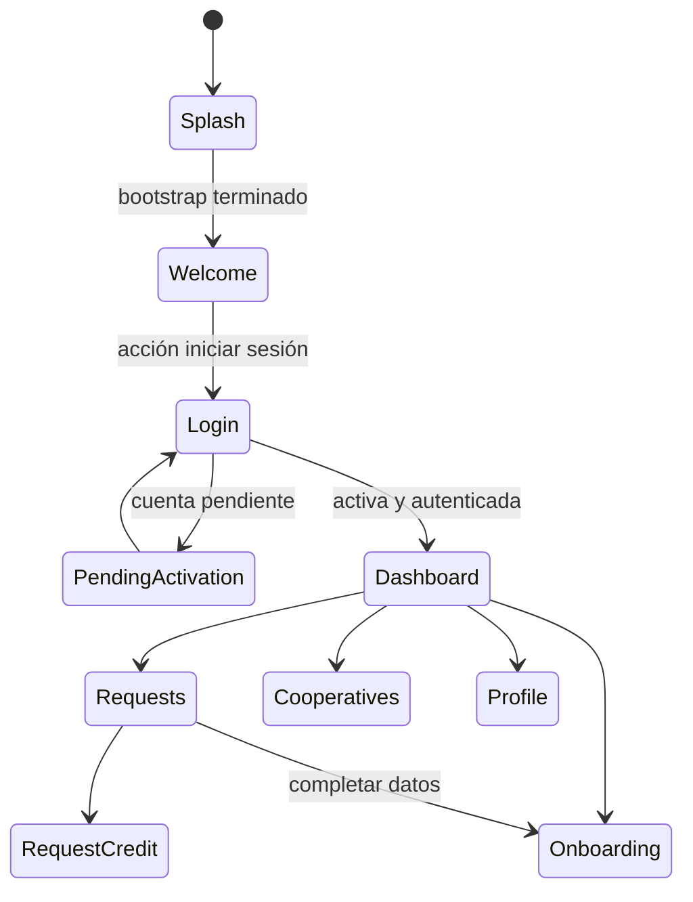

# Pantallas y navegación

## Router

`appRouterProvider` crea `GoRouter`, inicia en `/splash`, escucha `AuthController` con `refreshListenable` y aplica redirecciones según bootstrap, autenticación y estado de activación. `ShellRoute` envuelve cuatro destinos con `AppShell`; el resto son rutas independientes. Algunas páginas usan transición fade + desplazamiento de 280 ms.

| Ruta | Pantalla | Acceso efectivo según redirect |
|---|---|---|
| `/splash` | `SplashPage` | Inicial; redirige a welcome al terminar bootstrap |
| `/welcome` | `WelcomePage` | Pública |
| `/login`, `/register` | Login, registro | Públicas |
| `/activate`, `/complete-registration`, `/verify-registration` | Activación/verificación/clave | Públicas; parámetros query `token`/`email` |
| `/forgot-password`, `/reset-password` | Recuperación | Públicas; reset lee `token` |
| `/pending-activation` | Estado pendiente | Permitida para cuenta que requiere activación |
| `/simulate-credit`, `/simulate-investment` | Simuladores | Públicas |
| `/onboarding`, `/guarantor-onboarding` | Onboarding solicitante/garante | No clasificadas como públicas; requiere sesión activa |
| `/request-credit` | Crear solicitud | No pública; requiere sesión activa |
| `/dashboard`, `/requests`, `/cooperatives`, `/profile` | Inicio y navegación principal | Dentro de `ShellRoute`, sesión activa |

En estado `isBootstrapping`, solo permanece `/splash`; sin sesión se conserva una lista de rutas públicas y las demás redirigen a `/login`. Con `requiresActivation`, se permite `/pending-activation` y rutas públicas. Un usuario autenticado que entra en login/register/splash/pending-activation se envía a dashboard.

El diagrama representa rutas/acciones verificadas, no todos los detalles de guardas ni el éxito de cada operación. El shell traduce índice 0–3 a dashboard, requests, cooperatives y profile; el índice se calcula por prefijo del URI.

## Enlaces de implementación

[`lib/app/router/app_router.dart`](../lib/app/router/app_router.dart), [`lib/app/shell/app_shell.dart`](../lib/app/shell/app_shell.dart), [`lib/features/dashboard/presentation/dashboard_page.dart`](../lib/features/dashboard/presentation/dashboard_page.dart), [`lib/features/requests/presentation/requests_page.dart`](../lib/features/requests/presentation/requests_page.dart).
