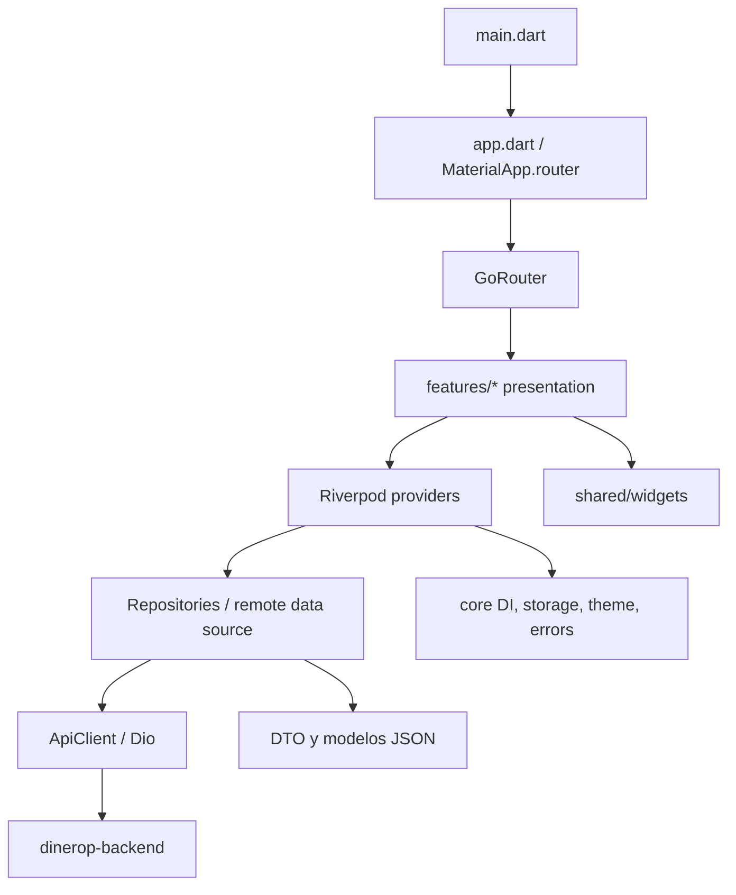

# Dinerup App — visión del proyecto

## Propósito y alcance

Aplicación móvil Flutter/Dart para flujos de cliente de Dinerop: acceso y registro, captura de onboarding, creación/consulta de solicitudes de crédito, consulta del catálogo de cooperativas, perfil y simuladores. Esta descripción se limita a pantallas, rutas y llamadas presentes en `lib/`; no implica que todos los flujos estén habilitados en producción.

## Mapa rápido

- Entrada y composición: [`lib/main.dart`](../lib/main.dart), [`lib/app/app.dart`](../lib/app/app.dart).
- Rutas y shell: [`lib/app/router/app_router.dart`](../lib/app/router/app_router.dart), [`lib/app/shell/app_shell.dart`](../lib/app/shell/app_shell.dart).
- Dependencias de infraestructura: [`lib/core/di.dart`](../lib/core/di.dart).
- Red y configuración: [`lib/core/network/api_client.dart`](../lib/core/network/api_client.dart), [`lib/core/config/api_config.dart`](../lib/core/config/api_config.dart).
- Funcionalidades: `lib/features/{auth,onboarding,credit,cooperative,dashboard,requests,profile,welcome}/`.
- UI compartida: `lib/shared/widgets/`; tema y utilidades: `lib/core/`.

## Estructura observada

## Stack

`pubspec.yaml` declara Flutter, Riverpod 2, GoRouter, Dio, almacenamiento seguro, Firebase Messaging, notificaciones locales, internacionalización, SVG, URL launcher e impresión. El uso concreto de cada dependencia debe verificarse en los archivos Dart; la presencia en `pubspec` por sí sola no prueba que una función de producto esté completa.

## Límites y evidencia

Graphify se consultó sobre `graphify-out/graph.json` (1.345 nodos): los hubs relevantes incluyen `authControllerProvider`, `ApiClient`, los providers, y las pantallas de dashboard. Se contrastaron esas relaciones con imports/llamadas en los archivos citados. El backend accesible como checkout hermano es `../dinerop-backend`; los endpoints consumidos se cotejaron con sus controladores Java, no solo con `API_DOCUMENTATION.md`. Ver [`API_INTEGRATION.md`](API_INTEGRATION.md) para discrepancias y [`DEVELOPMENT_GUIDE.md`](DEVELOPMENT_GUIDE.md) para ejecución/configuración.
