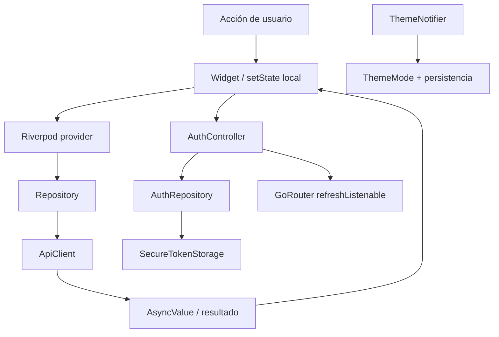

# Gestión del estado

## Mecanismos presentes

1. **Riverpod**: `ProviderScope` en el arranque; `Provider` para objetos de infraestructura/repositorios; `FutureProvider.autoDispose` para carga asíncrona de solicitudes, onboarding, perfil y cooperativas.
2. **ChangeNotifier**: `AuthController` lleva estado de bootstrap, busy/error, token/usuario, activación, onboarding y email reciente. `ChangeNotifierProvider` lo expone; el router escucha el mismo objeto.
3. **StateNotifier**: `ThemeNotifier` gestiona `ThemeMode` y persiste el valor.
4. **Estado local Flutter**: formularios, filtros, overlays, selección y loaders puntuales usan `StatefulWidget`/`setState`.

## Estado global / asíncrono

`app/providers.dart` contiene `dashboardCreditRequestsProvider`, `dashboardOnboardingStatusProvider`, `clientProfileProvider`, `cooperativesProvider` y `requestsProvider`. Son auto-dispose y permiten a páginas renderizar `loading/data/error`. La pantalla de solicitudes también mantiene filtros locales; las operaciones de aceptación/loading se guardan en estado del widget/oferta.

`AuthController` restaura sesión durante bootstrap, valida estado de onboarding de clientes activos y notifica listeners después de cambios. Login guarda token/usuario y posteriormente sincroniza el estado de onboarding. Logout limpia almacenamiento y memoria. Un HTTP 401 autenticado hace que el interceptor borre almacenamiento; la lógica de controlador también maneja un 401 al comprobar la sesión persistida.

## Invalidez y actualización

Se observan providers auto-dispose para cargas. No se documenta una política general de cache/invalidation o refresh automática para cada acción; revisar el sitio de llamada antes de asumirla. El flujo de aceptación en `requests_page.dart` interactúa directamente con `CreditRepository`; el comportamiento posterior debe leerse allí.

## Fuentes

[`lib/app/providers.dart`](../lib/app/providers.dart), [`lib/features/auth/presentation/auth_controller.dart`](../lib/features/auth/presentation/auth_controller.dart), [`lib/core/theme/theme_provider.dart`](../lib/core/theme/theme_provider.dart), [`lib/features/requests/presentation/requests_page.dart`](../lib/features/requests/presentation/requests_page.dart).
