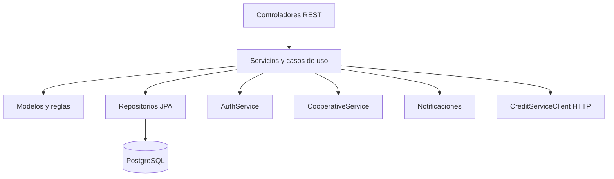

# ARCHITECTURE

## Estilo

Monolito Spring Boot organizado por dominios con capas mixtas. `credit` y `cooperative` separan `domain` e `infrastructure`; `onboarding` incluye `application`, `domain`, `infrastructure`; `auth` usa `controller/service/repository/entity`. No es una arquitectura de microservicios: `OnboardingServiceImpl` llama directamente a `CreditService`.

## Relaciones y dependencias

Controladores convierten HTTP/DTO y delegan. Los servicios coordinan repositorios y dominios. `credit/domain/service/CreditService.java` integra solicitudes, identidad, cooperativas, onboarding, notificaciones y requisitos. Spring Data JPA implementa repositorios; entidades definen mapeo persistente. `onboarding/infrastructure/client/CreditServiceClient.java` encapsula HTTP donde se usa, junto a coordinación directa dentro del mismo proceso.

Integraciones: correo Resend (`notification/config/ResendConfig.java`), push Firebase (`notification/config/FirebaseConfig.java`), WebClient y PDF (`CreditReferralPdfService`).

## Paquetes y errores

Dominios: `admin`, `auth`, `cooperative`, `credit`, `notification`, `onboarding`, `visits`. Hay manejadores de excepciones por área; no asumir formato único. Seguridad y CORS están en `auth/config/SecurityConfig.java`.

## Graphify

`graphify-out/GRAPH_REPORT.md` marca como centrales `User`, `AuthService`, `UserRepository`, `CooperativeService`, `SolicitudOnboarding`, `CreditService`, `CreditRequest`, `SolicitudCooperativaRepository`, `Cooperative` y `Role`. Reporta aristas extraídas e inferidas y cero ciclos. Centralidad no equivale a propiedad funcional; verificar imports, inyección y llamadas.
