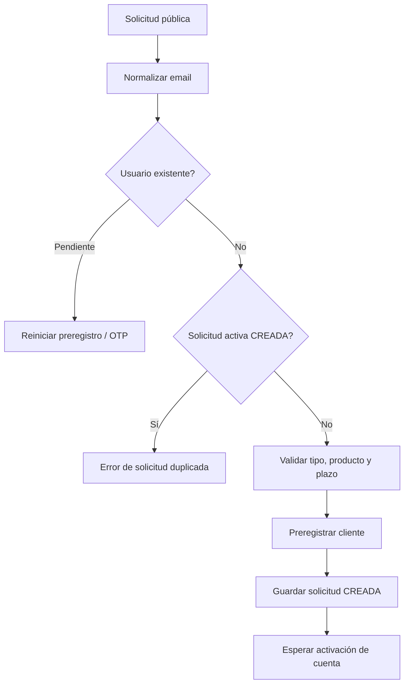
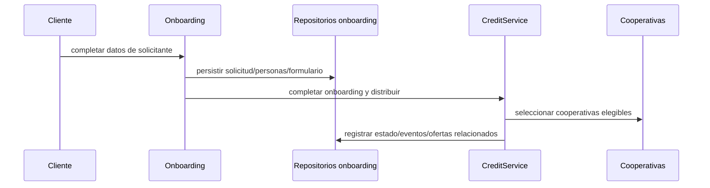

# BUSINESS_LOGIC

Los siguientes flujos están respaldados por servicios/casos de uso actuales. Los estados y reglas exhaustivos deben leerse en los enums y métodos citados.

## Solicitud pública de crédito

`CreditController` delega en `CreditService.createPublicRequest`. El servicio normaliza correo, gestiona reintento para registro pendiente, detecta solicitud activa, valida combinación de tipo de operación y tipo de crédito, limita plazo a 1–360 meses cuando se informa, preregistra al cliente y guarda `CreditRequest` en estado `CREADA`. El servicio devuelve un estado de activación pendiente; no asumir aprobación crediticia.

## Onboarding y distribución

`OnboardingServiceImpl.crearSolicitudConSolicitante` evita que usuario cree formulario duplicado, guarda solicitud y persona solicitante (y cónyuge cuando corresponde), marca el formulario y solicitud completados y llama a `CreditService.completeOnboardingAndDispatch`. `solicitarGarante` verifica que la solicitud esté en estado de onboarding COMPLETADO y coordina el servicio de crédito. Las operaciones están transaccionales a nivel de servicio, con posible interacción de notificaciones/servicios; no inferir atomicidad de efectos externos.

## Decisiones y aceptación

La API permite a cooperativas consultar solicitudes, decidir, solicitar garante y registrar decisión de garante; el cliente consulta preaprobación y acepta una oferta. `CreditService`, `ClientCreditAcceptanceService`, `CooperativeCreditDecisionService` y servicios de consulta implementan estas tareas. Las transiciones válidas se codifican en métodos y enums `CreditRequestStatus`, `SolicitudCooperativaStatus`, `EstadoGarante`; revisar ambos lados antes de cambiar flujos.

## Administración

Servicios `UserAdminService`, `CooperativeAdminService` y `DashboardService` ofrecen gestión y resúmenes para ADMIN. `CooperativeSpecification` permite componer búsqueda de cooperativas. No asumir políticas de eliminación lógica salvo evidencia en servicio/entidad.

## Integraciones

- Email: Resend, a través de `NotificationService` y builders.
- Push: Firebase Cloud Messaging, a través de `PushNotificationService` y tokens de dispositivo.
- Cooperativas / onboarding-credit: servicio HTTP `CreditServiceClient` cuando se usa; hay coordinación interna directa de `CreditService` en otros casos.
- PDF: `CreditReferralPdfService` y OpenPDF.

No está verificado qué proveedor/endpoint concreto está activo en producción ni la entrega real de mensajes.
