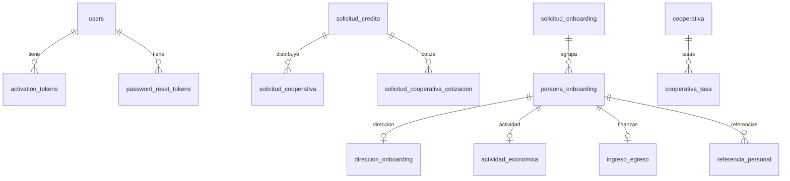

# DATABASE

## Fuente y cautelas

Tablas/columnas se resumen desde `schema.sql`; relaciones se contrastaron con anotaciones `@Entity`, `@Table` y `@JoinColumn` en Java. El SQL es un snapshot de referencia; no se halló historial de migraciones en el inventario revisado. El esquema activo y la estrategia de DDL dependen del perfil/entorno.

## Grupos

- Identidad: `users`, `user_pre_registration`, `activation_tokens`, `password_reset_tokens`.
- Crédito: `solicitud_credito`, `solicitud_cooperativa`, `solicitud_cooperativa_cotizacion`, `solicitud_cooperativa_evento`.
- Onboarding: `solicitud_onboarding`, `persona_onboarding`, `direccion_onboarding`, `actividad_economica`, `ingreso_egreso`, `referencia_personal`.
- Cooperativas: `cooperativa`, `cooperativa_tasa`.
- Métrica: `page_visits`.
- `PushDeviceToken` mapea `push_device_tokens`; clases JPA también declaran `email_verification_otps` y `credit_requirements`, ausentes de este snapshot SQL. Verificar el esquema real.

Relaciones dibujadas reflejan FK/associations visibles; algunas relaciones JPA no tienen FK explícita en el SQL. No inferir restricciones no declaradas.

## Restricciones y clases

`schema.sql` declara unicidad para tokens, relaciones uno-a-uno de onboarding y par cooperativa/tipo de tasa; incluye checks para ciertos enums de onboarding y tasas. En Java, enums relevantes se guardan como strings. Revisar entidades en `auth/entity`, `credit/domain/model`, `onboarding/domain/entity`, `cooperative/domain/entity`, `notification/entity`, `visits/domain/entity`; los repositorios `*Repository.java` contienen consultas.

La tabla de identidad referenciada como `users(id_user)` y tablas ausentes hacen incompleto el snapshot para derivar el modelo relacional entero. Confirmar antes de migraciones o consultas nuevas.
