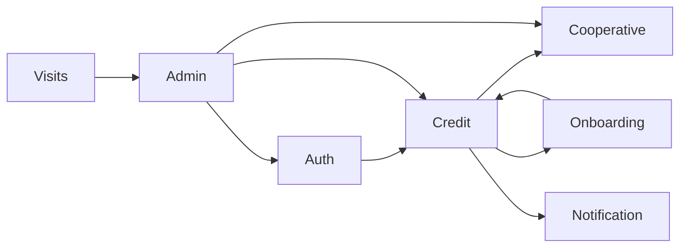

# MODULES

| Módulo | Responsabilidad observable | Ejemplos |
|---|---|---|
| `auth` | Registro, OTP, JWT, recuperación y usuarios | `AuthController`, `AuthService`, `JwtService`, `UserRepository`, `User` |
| `credit` | Solicitudes, distribución, cotizaciones, decisiones y requisitos | `CreditController`, `CreditService`, `CreditDistributionService`, `CreditRequest` |
| `onboarding` | Formularios de solicitante y garante | `OnboardingClienteController`, casos de uso, `OnboardingServiceImpl` |
| `cooperative` | Catálogo y tasas | `CooperativeController`, `CooperativeService`, entidades |
| `admin` | Usuarios, cooperativas y dashboard | controladores `UserAdmin`, `CooperativeAdmin`, `Dashboard` |
| `notification` | Correo y push | `NotificationService`, builders, `PushNotificationService` |
| `visits` | Registro y consulta de visitas | `VisitController`, `VisitService`, `PageVisitRepository` |

Las flechas reflejan coordinación/referencias, no necesariamente red. Por ejemplo, `CreditService` usa cooperativas y notificaciones; onboarding completa el flujo invocando `CreditService`.

Persistencia por dominio: auth (usuarios, roles, preregistro y tokens); credit (solicitudes, asignaciones, cotizaciones, eventos y requisitos); onboarding (solicitud, personas y datos relacionados); cooperative (cooperativas/tasas); notification (tokens de dispositivo); visits (contador). Ver [DATABASE.md](DATABASE.md).
