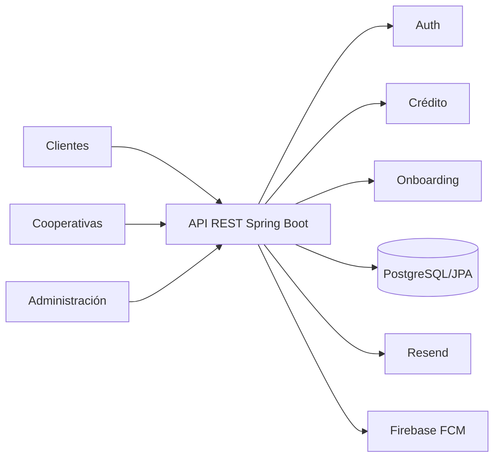

# PROJECT_OVERVIEW

## Alcance

`dinerop-backend` es una aplicación Java/Spring Boot con APIs REST para autenticación, cooperativas, crédito, onboarding, administración, notificaciones y visitas. Evidencia: `src/main/java/com/markup/dinerop/DineropBackendApplication.java` y sus paquetes.

No se verifica aquí la arquitectura del frontend, SLA, reglas legales, configuración productiva real ni todos los consumidores externos. La descripción se limita a capacidades observables en backend.

## Stack comprobado

Java 17, Spring Boot 3.3.2, Spring MVC, Security, Data JPA, Validation, PostgreSQL runtime, H2 test, JJWT 0.11.5, springdoc OpenAPI, MapStruct y Lombok. Dependencias de integración: Resend, Firebase Admin/FCM, WebClient y OpenPDF. Fuente: `pom.xml`.

## Fuentes y límites

- Código: `src/main/java/com/markup/dinerop/`.
- Configuración: `src/main/resources/application.yaml`, `application-prod.yaml`.
- SQL de referencia: `schema.sql`.
- Grafo: `graphify-out/GRAPH_REPORT.md`, `graphify-out/graph.json`; informa 1.406 nodos, 3.508 aristas y cero ciclos de importación. Es un snapshot derivado, no contrato de runtime.

`application.yaml` selecciona `dev`; el despliegue efectivo depende del entorno.
