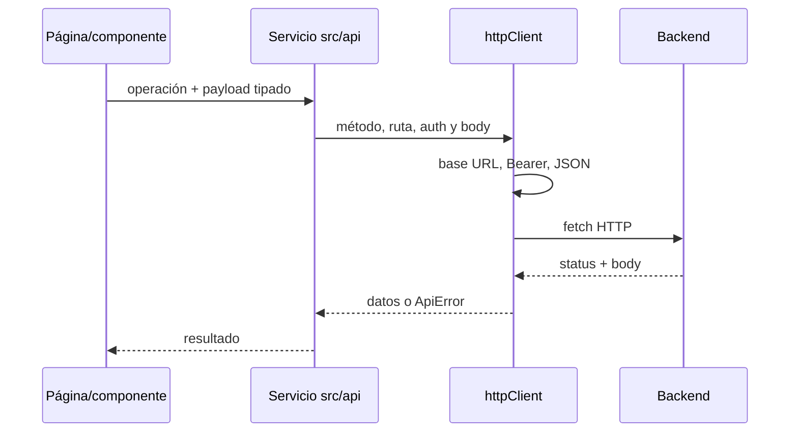

# Integración con API

## Transporte

`src/api/config.ts` requiere `VITE_API_BASE_URL` y elimina barras finales; si falta, lanza un error al importar la configuración. `.env.example` muestra `http://localhost:8080`. `httpClient` construye URL absoluta, serializa objetos como JSON, solicita JSON, agrega `Authorization: Bearer <token>` según reglas de ruta, parsea respuesta de forma defensiva y lanza `ApiError` para respuestas HTTP fallidas. En un 401 autenticado emite `app:auth-unauthorized` salvo que `logoutOnUnauthorized` sea falso.

## Endpoints observados en el frontend

| Método | Ruta | Servicio / propósito |
|---|---|---|
| GET | `/api/cooperatives` | Obtener cooperativas |
| GET, POST | `/api/credits/me` | Listar solicitudes del cliente / crear solicitud |
| GET | `/api/credits/cooperative/me/requests` | Bandeja de la cooperativa |
| PUT | `/api/credits/cooperative/me/requests/{id}/decision` | Decidir solicitud con oferta/requisitos |
| GET | `/api/credits/cooperative/me/requests/{id}/offer-defaults` | Valores sugeridos de oferta |
| PUT | `/api/credits/cooperative/me/requests/{id}/solicitar-garante` | Solicitar garante |
| GET | `/api/credits/me/{id}/pre-approved` | Cooperativas con preaprobación |
| PUT | `/api/credits/me/{id}/cooperatives/{cooperativeId}/accept` | Aceptar cooperativa |
| GET | `/api/credits/cooperative/me/requests/{id}/timeline` | Timeline de solicitud |
| PUT | `/api/credits/cooperative/me/requests/{id}/garante-decision` | Resolver decisión de garante |
| POST | `/api/onboarding/cliente/solicitante` | Guardar onboarding |
| GET | `/api/onboarding/cooperativa/{id}` | Detalle de personas para expediente |
| GET | `/api/onboarding/cliente/mi-ubicacion` | Ubicación del cliente |
| GET | `/api/onboarding/cliente/formulario-status` | Estado de formulario |
| GET | `/api/onboarding/cliente/pre-registration` | Datos pre registrados |
| POST | `/api/onboarding/cliente/garante/completar` | Completar onboarding de garante |
| GET, POST | `/api/visits` | Leer/incrementar contador; sin autenticación explícita |
| POST | `/api/credits/public-request` | Solicitud pública desde modal |

`src/api/auth/auth.api.ts` usa `/api/auth/login`, `/activate`, `/complete-registration`, endpoints de inicio/verificación/reenvío/cambio de email y contraseña, y `/password/forgot` y `/password/reset`. El prefijo `/api/auth/` está exento del bearer automático.

## Esquema de llamada

Las reglas públicas explícitas adicionales en `httpClient` son `POST /api/credits/public-request` y `POST /api/cooperatives`. Se puede sobrescribir con opción `auth`. Los endpoints reflejan únicamente lo que el frontend intenta invocar; no se dispone aquí del código de backend ni de un contrato OpenAPI.

## Otras integraciones

`package.json` contiene `@supabase/supabase-js`, pero no se detectó uso en el código fuente. No se encontraron SDKs o adaptadores de terceros adicionales para backend. `lucide-react` aporta iconos; Swiper está en dependencias (el uso debe confirmarse en los imports de fuente). `fetch` es la integración HTTP efectiva.

## Referencias

- [src/api/httpClient.ts](../src/api/httpClient.ts), [src/api/config.ts](../src/api/config.ts)
- [src/api/auth/auth.api.ts](../src/api/auth/auth.api.ts), [src/api/creditRequests.api.ts](../src/api/creditRequests.api.ts), [src/api/onboarding.api.ts](../src/api/onboarding.api.ts), [src/api/cooperatives.api.ts](../src/api/cooperatives.api.ts)
