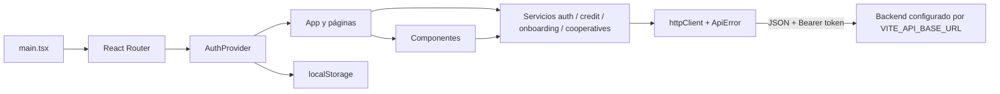

# Arquitectura

## Estilo y ejecución

Frontend SPA con React y TypeScript, compilado/servido por Vite. React Router DOM administra las URLs y los guards de acceso. No hay runtime de servidor Next.js, rutas de API dentro del frontend ni separación Server/Client Components. El backend se consume por HTTP usando `fetch`.

## Capas y dependencias

Las páginas y componentes guardan la mayor parte del estado de interfaz con hooks de React. La carpeta `api/` separa transporte compartido de operaciones de dominio. `types/` define contratos de datos para créditos y onboarding.

## Arranque

`src/main.tsx` monta el árbol en `#root`, bajo `React.StrictMode`, `BrowserRouter` y `AuthProvider`. `src/App.tsx` define rutas anidadas mediante `Outlet`. `src/index.css` aporta estilos globales; Tailwind está configurado mediante sus archivos de raíz.

## Construcción y despliegue

Los comandos disponibles son `dev`, `build`, `lint`, `preview` y `typecheck` (ver `package.json`). Vite produce `dist`; Vercel y Netlify reescriben las rutas a `index.html` para la navegación SPA y definen cabeceras de caché.

## Límites de evidencia

No se encontraron rutas backend en el repositorio; los endpoints documentados son llamadas hechas por el frontend y no certifican implementación o semántica del servidor. `@supabase/supabase-js` figura como dependencia, pero no se encontraron imports/uso en `src`. `src/utils/mockAPI.ts` implementa almacenamiento simulado en localStorage; los dashboards observados usan servicios HTTP, por lo que no se debe asumir que esa utilidad alimenta la aplicación actual.

## Referencias

- [src/main.tsx](../src/main.tsx), [src/App.tsx](../src/App.tsx), [vite.config.ts](../vite.config.ts)
- [src/api/httpClient.ts](../src/api/httpClient.ts), [src/api/config.ts](../src/api/config.ts), [src/api/errors.ts](../src/api/errors.ts)
