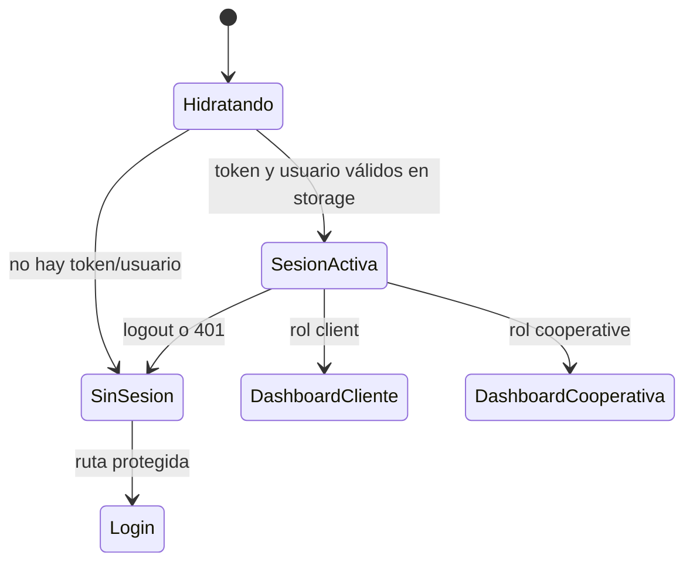

# Autenticación

## Sesión en cliente

`AuthProvider` mantiene `user`, `token`, `isLoading` e `isAuthenticated` en React Context. Al montar, lee token y usuario desde localStorage; si falta uno, limpia la sesión. El login llama a `/api/auth/login`, extrae token (`accessToken`, `access_token`, `token` o `jwt`) y usuario y persiste ambos. El almacenamiento usa las claves `auth_token` y `auth_user`, migra claves antiguas (`access_token`, `accessToken`, `token`) y normaliza un posible prefijo `Bearer`.

`useAuth()` expone contexto y lanza error si se usa fuera del provider. `logout()` elimina datos locales. Los errores 401 autenticados generan un evento de ventana; el provider escucha el evento y cierra sesión. El cliente HTTP no adjunta token a rutas de autenticación.

## Flujo de protección

Los guards son de interfaz y basados en rol (`ProtectedRoute`); la autorización definitiva debe residir también en el backend, aunque ese código no está presente.

## Flujos de credenciales

- Inicio de sesión.
- Registro en pasos con inicio/verificación/reenvío OTP, cambio de email y asignación de contraseña, orquestado por `CompleteRegistrationModal`.
- Activación de cuenta con token de URL.
- Solicitud de recuperación y restablecimiento mediante token.

No se observan cookies de sesión ni un proveedor OAuth en estas implementaciones. La persistencia de token en localStorage es evidencia del mecanismo actual, no recomendación de seguridad.

## Referencias

- [src/context/AuthContext.tsx](../src/context/AuthContext.tsx), [src/context/auth-context.ts](../src/context/auth-context.ts), [src/context/useAuth.ts](../src/context/useAuth.ts)
- [src/api/auth/authStorage.ts](../src/api/auth/authStorage.ts), [src/api/auth/authEvents.ts](../src/api/auth/authEvents.ts), [src/App.tsx](../src/App.tsx)
- [src/api/auth/auth.api.ts](../src/api/auth/auth.api.ts), [src/components/auth/CompleteRegistrationModal.tsx](../src/components/auth/CompleteRegistrationModal.tsx)
