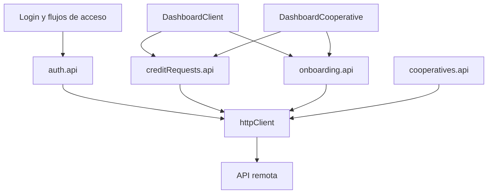

# Módulos

| Módulo | Ubicación | Responsabilidad observada |
|---|---|---|
| Arranque y navegación | `src/main.tsx`, `src/App.tsx` | Montaje SPA, provider, rutas y guards |
| Autenticación | `src/context/`, `src/api/auth/`, `src/pages/Login.tsx`, `src/pages/password/`, `ActivateAccount.tsx` | Sesión, login, registro por OTP, activación y contraseñas |
| Transporte | `src/api/config.ts`, `httpClient.ts`, `errors.ts` | URL base, fetch JSON, bearer, manejo uniforme de errores |
| Créditos | `src/api/creditRequests.api.ts`, `src/components/credit/`, dashboards | Crear/consultar solicitudes, ofertas, decisiones y aceptación |
| Onboarding | `src/api/onboarding.api.ts`, `src/pages/OnboardingPage.tsx`, `src/pages/steps/`, `src/components/onboarding/` | Formulario de cliente y garante, estado y detalle |
| Cooperativas | `src/api/cooperatives.api.ts`, `src/components/cooperative/`, `src/data/cooperatives.ts` | Listado/carrusel y presentación de cooperativas |
| Inversiones | `src/components/investment/NewInvestmentModal.tsx` | UI de formulario de inversión; la integración backend no está demostrada en ese componente |
| Layout y promoción | `src/components/layout/` | Navbar, footer, popup, contador y placeholder |
| Modelos y catálogos | `src/types/`, `src/data/` | Contratos, estados y datos estáticos |
| Utilidad heredada | `src/utils/mockAPI.ts` | API demo con almacenamiento local |

## Relaciones principales

## Tipos compartidos

`src/types/credit.ts`, `creditEstado.ts`, `creditDecision.ts`, `cooperative.ts` y `onboarding.ts` describen entidades y estados usados entre UI y servicios. `src/api/onboarding.api.ts` también contiene interfaces de payload/respuesta orientadas a su API.

## Referencias

- [src/api/](../src/api/), [src/components/](../src/components/), [src/pages/](../src/pages/)
- [src/context/AuthContext.tsx](../src/context/AuthContext.tsx), [src/types/](../src/types/)
