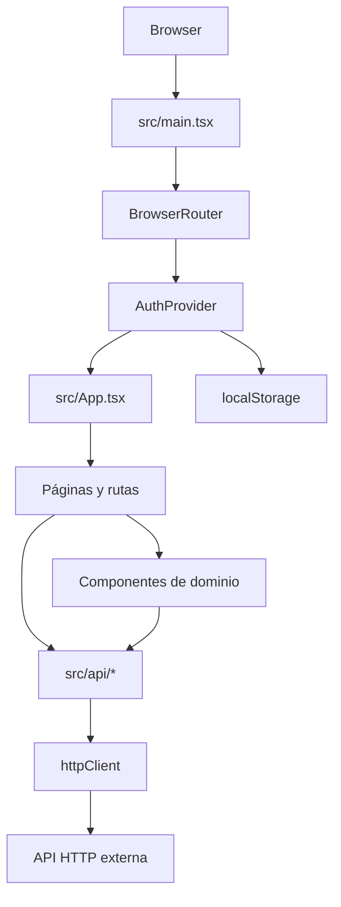

# Resumen del proyecto

## Identidad técnica

DinerUp es una aplicación web de una sola página para flujos de clientes y cooperativas: autenticación, registro, solicitud de crédito, onboarding y gestión de solicitudes. El repositorio no está implementado con Next.js 15 ni React 19. `package.json` declara Vite 5, React/React DOM 18.3 y React Router DOM 7.9. El enrutamiento es cliente (SPA), sin App Router ni Pages Router de Next.js.

## Estructura

```text
src/
  api/          cliente HTTP y servicios de dominio
  components/   UI agrupada por dominio/layout
  context/      contexto global de autenticación
  data/         catálogos estáticos
  images/       logos e imágenes
  pages/        vistas asociadas a rutas y pasos de onboarding
  types/        tipos TypeScript
  utils/        utilidades y API simulada heredada
```

El punto de entrada es `src/main.tsx`; `src/App.tsx` declara rutas. Vite genera `dist/`. Las reglas SPA de despliegue aparecen en `vercel.json` y `netlify.toml`.

## Arquitectura en una vista



## Áreas de producto observables

- Cliente: dashboard, formulario de onboarding y solicitudes personales.
- Cooperativa: dashboard de solicitudes recibidas, decisiones, expediente y timeline.
- Acceso público: inicio de sesión, activación, recuperación/restablecimiento y solicitud pública.
- Datos: catálogos locales de provincias/cooperativas y modelos TypeScript.

## Graphify

El repositorio incluye `graphify-out/GRAPH_REPORT.md`: reporta 420 nodos, 870 relaciones y 24 comunidades, sin ciclos de importación detectados en ese análisis. Señala `httpClient`, `DashboardCooperative`, `DashboardClient`, `getErrorMessage` y `useAuth` entre los nodos más conectados. El informe declara que se construyó desde el commit `79ce61f4`; no se pudo comparar con HEAD porque el entorno no permitió a Git cambiar al directorio del repositorio. El grafo sirve como índice de relaciones, no como sustituto de inspeccionar los fuentes.

## Referencias

- [package.json](../package.json), [src/main.tsx](../src/main.tsx), [src/App.tsx](../src/App.tsx)
- [graphify-out/GRAPH_REPORT.md](../graphify-out/GRAPH_REPORT.md), [vercel.json](../vercel.json), [netlify.toml](../netlify.toml)
