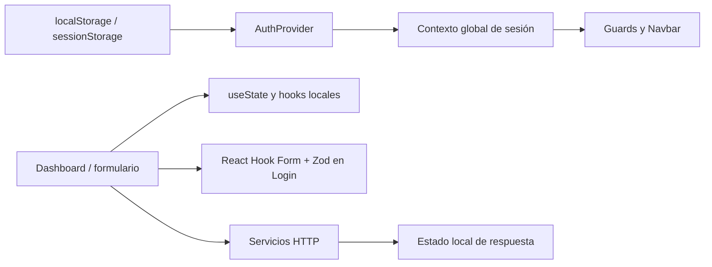

# Gestión de estado

## Estado global

Solo se encontró un estado global de dominio: autenticación en React Context (`AuthProvider`/`AuthContext`). Incluye usuario, token, carga inicial, acciones login/logout y actualización de usuario.

## Estado local

Las páginas mantienen datos de pantalla en `useState`: solicitudes y carga, secciones/filtros, selección de modales, errores, pasos de formularios y respuestas. `useEffect` realiza cargas al montar o al cambiar dependencias; `useMemo` deriva estadísticas/filtros; `useCallback` aparece para estabilizar manejadores usados en efectos.

Ejemplos: `DashboardClient` carga cooperativas, solicitudes y estado de onboarding; `DashboardCooperative` mantiene bandeja, filtros y expediente. `CreditDetailsModal` carga cooperativas disponibles. No se observan Redux, Zustand, TanStack Query, Apollo ni una capa de caché remota.

## Formularios

Login combina React Hook Form y Zod vía `@hookform/resolvers/zod`. Otros flujos mantienen estado controlado con hooks y validación imperativa en sus componentes (por ejemplo `NewCreditModal` y `PublicCreditRequestModal`). Los pasos de onboarding comparten información mediante props `data`/`setData` desde `OnboardingPage`.

## Persistencia del navegador

- `localStorage`: sesión; marcadores de activación en el flujo de activación; utilitario mock.
- `sessionStorage`: evita registrar varias visitas de plataforma durante la sesión actual.
- El resto de estado de página se pierde al desmontar/recargar salvo persistencia explícita descrita arriba.

## Referencias

- [src/context/AuthContext.tsx](../src/context/AuthContext.tsx), [src/pages/DashboardClient.tsx](../src/pages/DashboardClient.tsx), [src/pages/DashboardCooperative.tsx](../src/pages/DashboardCooperative.tsx)
- [src/pages/Login.tsx](../src/pages/Login.tsx), [src/pages/OnboardingPage.tsx](../src/pages/OnboardingPage.tsx), [src/components/layout/PlatformVisitsCounter.tsx](../src/components/layout/PlatformVisitsCounter.tsx)
